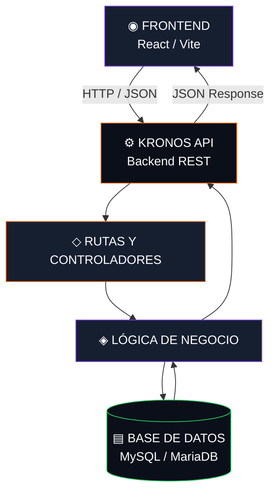

 
<div align="center">


<br/>


<br/>

**Una API diseñada para conectar, procesar y proteger la información del sistema de inventario KRONOS.**

<br/>


</div>

---

## `01` — ◈ Sobre el proyecto

**KRONOS API** es el componente backend del sistema *Kronos Inventory Control*, desarrollado como parte del programa Tecnólogo en Análisis y Desarrollo de Software del SENA.

Su propósito es centralizar la lógica del sistema, procesar las solicitudes del frontend y gestionar la información relacionada con los materiales, las existencias, los movimientos de inventario, los proveedores, las órdenes de compra y las garantías.

El backend busca reemplazar el manejo manual de la información por una gestión más organizada, trazable y confiable.

<div align="center">

| `CORE` | `PURPOSE` | `INTEGRATION` |
|:---:|:---:|:---:|
| Lógica de negocio | Control de inventario | Comunicación con frontend |

</div>

## `02` — ◈ Arquitectura del sistema

La API funciona como intermediaria entre la interfaz de usuario y la base de datos. Recibe solicitudes HTTP, valida la información, ejecuta la lógica correspondiente y devuelve respuestas al cliente.



### Flujo de una solicitud

1. El frontend envía una solicitud HTTP a un endpoint.
2. La API recibe la petición y valida los datos.
3. Se ejecuta la lógica de negocio correspondiente.
4. Se consulta o modifica la base de datos cuando es necesario.
5. El backend devuelve una respuesta con los datos o el resultado de la operación.

---

## `03` — ◈ Componentes funcionales

<details>
<summary><strong>▤ Inventario y movimientos</strong></summary>

Gestión de existencias y registro de operaciones relacionadas con los materiales.

- Consulta de disponibilidad.
- Registro de entradas y salidas.
- Seguimiento de movimientos.
- Identificación de existencias bajas o agotadas.

</details>

<details>
<summary><strong>◇ Materiales y clasificación</strong></summary>

Organización de los materiales según su información y clasificación.

- Consulta y administración de materiales.
- Organización por categorías y marcas.
- Validación de datos asociados a cada material.

</details>

<details>
<summary><strong>⇄ Proveedores y órdenes de compra</strong></summary>

Gestión de la información de proveedores y seguimiento de las órdenes de compra.

- Consulta de proveedores.
- Administración de órdenes.
- Seguimiento de estados de las órdenes.

</details>

<details>
<summary><strong>⬡ Garantías</strong></summary>

Organización de la información relacionada con las garantías de los productos.

- Consulta de garantías.
- Seguimiento del estado de las solicitudes.
- Gestión de la información asociada al proceso.

</details>

> Estos componentes describen el alcance funcional de KRONOS. Los endpoints y las operaciones disponibles deben coincidir con lo que esté implementado actualmente en el código.

## `04` — ◈ Tecnologías

<div align="center">

<!-- Ajusta los iconos para que coincidan con las tecnologías reales del backend -->


</div>

| Tecnología | Uso |
|---|---|
| **Node.js / framework backend** | Completar con el entorno y framework utilizados. |
| **MySQL / MariaDB** | Gestión de la base de datos relacional, según la configuración del proyecto. |
| **REST API** | Comunicación mediante solicitudes HTTP. |
| **JSON** | Formato de intercambio de información. |
| **Postman** | Pruebas de endpoints, si se utiliza en el proyecto. |
| **Swagger / OpenAPI** | Documentación de la API, si está configurada. |
| **Git y GitHub** | Control de versiones y colaboración. |

## `05` — ◈ Métodos HTTP

La API puede organizar sus operaciones siguiendo los métodos HTTP habituales de REST.

| Método | Propósito | Ejemplo ilustrativo |
|:---:|---|---|
| `GET` | Consultar información | Obtener materiales |
| `POST` | Crear un registro | Registrar un proveedor |
| `PUT` | Actualizar un recurso completo | Actualizar un material |
| `PATCH` | Modificar una parte del recurso | Cambiar el estado de una orden |
| `DELETE` | Eliminar un recurso, cuando esté permitido | Eliminar un registro |

Los ejemplos son orientativos; las rutas y los métodos definitivos deben verificarse en el código de la API.

## `06` — ◈ Respuestas HTTP

Las respuestas deben comunicar claramente el resultado de cada solicitud.

| Código | Significado |
|:---:|---|
| `200` | Solicitud procesada correctamente |
| `201` | Recurso creado correctamente |
| `400` | Datos o solicitud inválidos |
| `401` | Autenticación requerida o inválida |
| `403` | Acceso no permitido |
| `404` | Recurso o endpoint no encontrado |
| `500` | Error interno del servidor |

Los códigos deben utilizarse según el resultado real de cada operación.

## `07` — ◈ Seguridad de la API

La seguridad debe formar parte del diseño del backend para proteger los datos y controlar el acceso a las operaciones.

- **Autenticación:** verificar la identidad del usuario.
- **Autorización:** controlar el acceso según el rol y los permisos.
- **Validación de datos:** comprobar la información recibida antes de procesarla.
- **Manejo de errores:** devolver respuestas controladas sin exponer información sensible.
- **CORS:** definir qué orígenes pueden consumir la API.
- **Variables de entorno:** mantener credenciales y configuraciones fuera del código público.
- **JWT:** utilizar tokens de autenticación si este mecanismo está implementado.

> Marca como implementadas únicamente las medidas que ya estén configuradas y comprobadas.

## `08` — ◈ Instalación y ejecución

### Requisitos previos

- Git.
- Node.js y npm, si el backend utiliza ese entorno.
- MySQL o MariaDB, si esa es la base de datos configurada.
- Las dependencias y herramientas requeridas por el proyecto.

### 1. Clonar el repositorio

```bash
git clone <URL_DEL_REPOSITORIO_BACKEND>
cd <CARPETA_DEL_BACKEND>
```

### 2. Instalar las dependencias

Para un backend basado en Node.js:

```bash
npm install
```

### 3. Configurar las variables de entorno

Crea el archivo `.env` siguiendo la configuración que espera el proyecto. Por ejemplo, **solo si esas variables coinciden con tu código**:

```env
PORT=3000
DB_HOST=localhost
DB_PORT=3306
DB_NAME=kronosv3
DB_USER=tu_usuario
DB_PASSWORD=tu_clave
```

No publiques contraseñas reales ni subas el archivo `.env` a GitHub. Si el backend utiliza otras variables o una configuración distinta, conserva los nombres definidos en el proyecto.

### 4. Ejecutar el servidor

Si `package.json` tiene un script llamado `dev`:

```bash
npm run dev
```

Si el proyecto utiliza otro comando, ejecuta el script que esté definido en su `package.json`.

---

## `09` — ◈ Pruebas y documentación

Antes de integrar un endpoint con el frontend, verifica:

- Que la ruta responda con el método HTTP correcto.
- Que los datos requeridos se validen.
- Que la respuesta tenga la estructura esperada.
- Que los errores devuelvan códigos HTTP apropiados.
- Que los permisos se apliquen correctamente, cuando corresponda.

**Herramientas de apoyo:** Postman para probar solicitudes y Swagger/OpenAPI para documentar los endpoints, si están disponibles.

<div align="center">

<a href="https://www.postman.com/"></a>
<a href="https://swagger.io/specification/"></a>

</div>

## `10` — ◈ Estructura del proyecto

La estructura debe ajustarse a las carpetas reales del repositorio. Una organización posible para una API es:

```text
KRONOS-BACKEND/
│
├── src/
│   ├── config/          # Configuración de la aplicación
│   ├── routes/          # Definición de endpoints
│   ├── controllers/     # Manejo de solicitudes y respuestas
│   ├── services/        # Lógica de negocio
│   ├── middlewares/     # Validaciones y controles transversales
│   └── app.js           # Configuración principal, si aplica
│
├── tests/               # Pruebas, si existen
├── .env.example         # Plantilla de variables, sin secretos
├── .gitignore
├── package.json
└── README.md
```

Esta es una estructura de referencia, no una descripción confirmada de las carpetas actuales.

---

## `11` — ◈ Objetivo del desarrollo

KRONOS busca contribuir a una gestión más organizada del inventario de Ferretería y Perfilería Solmet, facilitando el seguimiento de las existencias y de los procesos relacionados con los materiales.

El backend constituye la capa encargada de procesar las operaciones del sistema, aplicar las reglas definidas y permitir que los componentes autorizados intercambien información de manera estructurada.

---

<div align="center">


**KRONOS INVENTORY CONTROL**

<sub>Desarrollado como proyecto formativo · SENA · ADSO</sub>

<br/>


</div>
